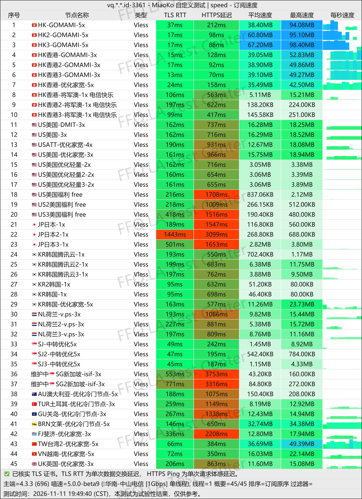
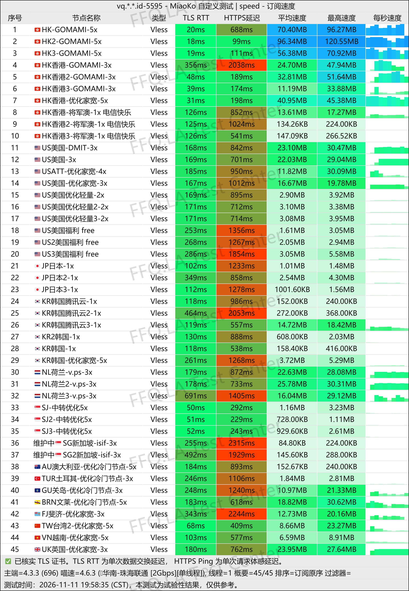
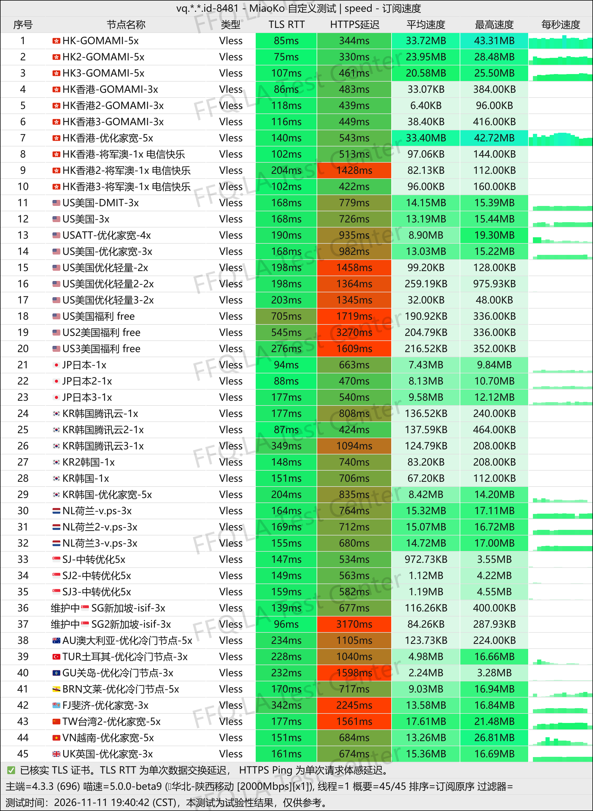
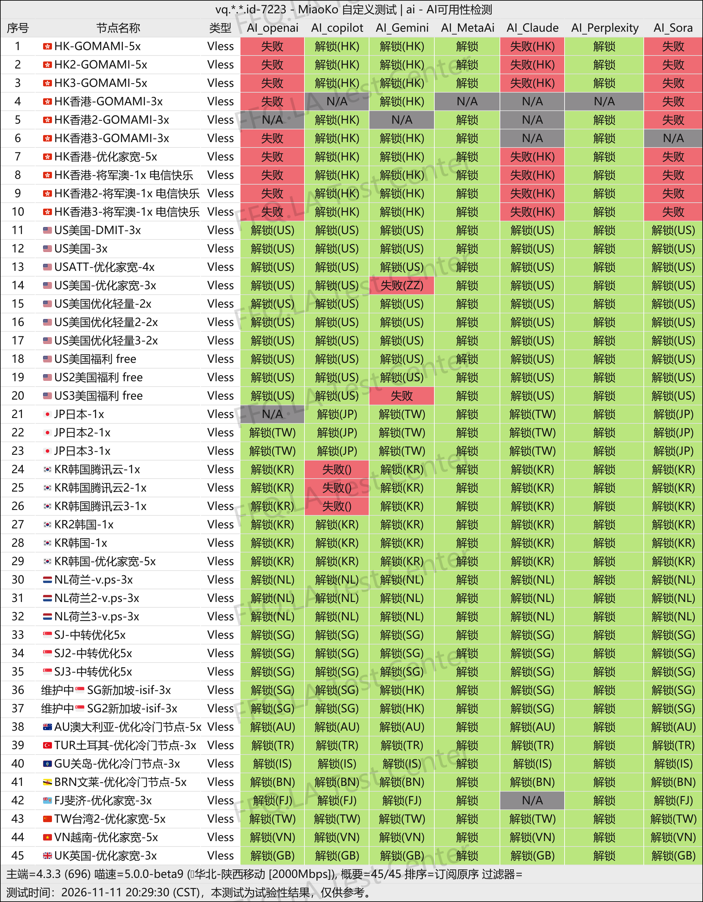
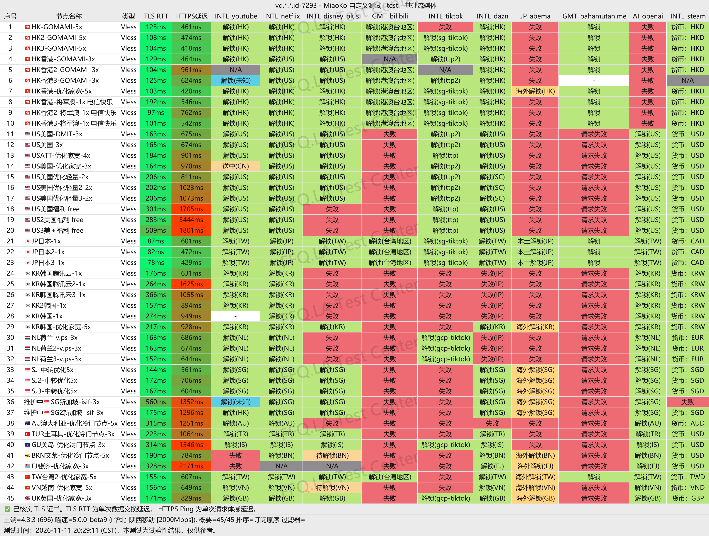
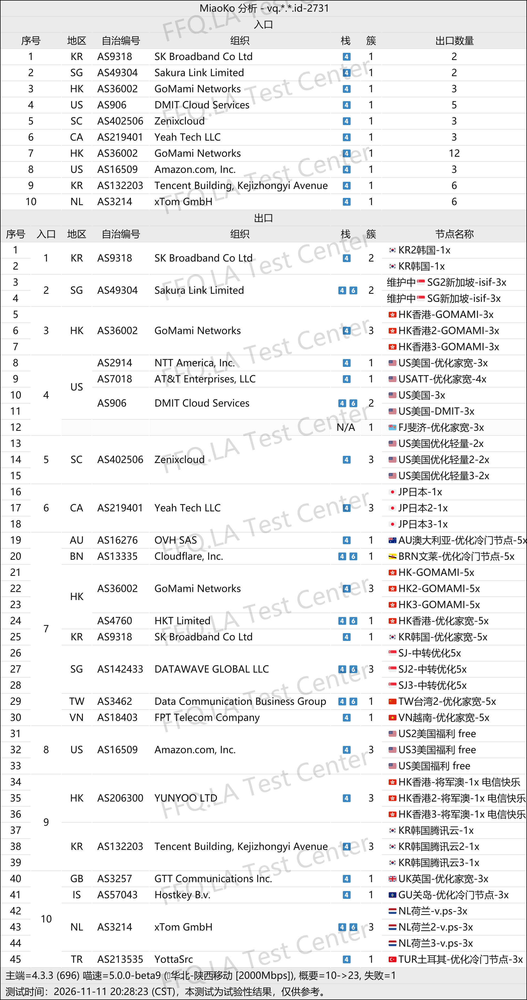

🇨🇳 中文 | 🇺🇸 [English](README_EN.md) | 🇷🇺 
[Русский](README_RU.md) | 🇮🇷 [فارسی](README_FA.md)

# Taffy 塔菲云机场官方地址(2026年11月14日更新)
Taffy 塔菲云机场官网地址</br>
`原品牌VANQCore放心云`

最新地址：[vq.wanwan.biz.id](https://to.iix.im/vanq01)</br>
官方地址：[vq.wanwan.biz.id](https://to.iix.im/vanq01)</br>

2026最新好用的机场推荐与节点分享：[https://github.com/jdnei/JiChangTuiJian](https://github.com/jdnei/JiChangTuiJian)</br>
## Telegram VPN 机场福利社 #AD
[机场抽奖群](https://331024.de/archives/choujiang)｜[机场聊天群](https://331024.de/archives/choujiang)｜[机场体验群](https://331024.de/archives/choujiang)</br>

[https://331024.de/archives/choujiang](https://331024.de/archives/choujiang)
## 邀请码
```bash
jqMqITHk
```
## 优惠码/折扣码
```bash
wanwan666
```
## 简介
Taffy 塔菲云机场是一家于2026年7月24日开业的网络加速服务商，主打海外中转线路，支持VMess、VLESS等协议。提供350GB至1350GB不同流量档位，以及一次性流量包，面向日常上网、流媒体观看、AI工具及跨境办公等需求，整体定位偏向多场景使用。
## 优势
Taffy 塔菲云机场主打海外中转与多倍率节点，提供350GB、550GB、850GB等常规套餐，支持月付、季付、半年付及年付，另有不限时流量包和限时优惠套餐。提供7×24小时工单服务，兼顾不同流量需求。部分高倍率节点表现较好，可根据实际网络环境选择适合的线路。
## 套餐

| 套餐           | 流量         | 价格               | 付款周期     | 流量重置价格 | 线路 / 节点                             | 流媒体解锁                                                | 特色 / 备注                          |
| ------------ | ---------- | ---------------- | -------- | ------ | ----------------------------------- | ---------------------------------------------------- | -------------------------------- |
| 588 双11限定套餐  | 1350GB     | ¥588 / 年（约¥49/月） | 年付       | ¥88    | 私享专线                                | 未注明                                                  | 双11限量8席；售完下架；商家标称年付优惠50%；支持折扣续费  |
| Breeze 微光    | 350GB      | ¥26 / 月          | 月付       | ¥26    | CN2 / 9929 / CMIN2 优化线路；全球节点、部分住宅IP | Netflix、Disney+、Prime Video、HBO Max、TikTok、Instagram | 三网优化；覆盖新疆等地区；宣称无日志；禁止倒卖及滥用       |
| Ember 萤火     | 550GB      | ¥40 / 月          | 月付       | ¥40    | CN2 / 9929 / CMIN2 优化线路；全球节点、部分住宅IP | Netflix、Disney+、Prime Video、HBO Max、TikTok、Instagram | 三网优化；覆盖新疆等地区；宣称无日志；禁止倒卖及滥用       |
| Glow 烛光      | 850GB      | ¥58 / 月          | 月付       | ¥58    | CN2 / 9929 / CMIN2 优化线路；全球节点、部分住宅IP | Netflix、Disney+、Prime Video、HBO Max、TikTok、Instagram | 三网优化；覆盖新疆等地区；宣称无日志；禁止倒卖及滥用       |
| Aether 辉耀    | 1350GB     | ¥88 / 月          | 月付       | ¥88    | CN2 / 9929 / CMIN2 优化线路；全球节点、部分住宅IP | Netflix、Disney+、Prime Video、HBO Max、TikTok、Instagram | 三网优化；覆盖新疆等地区；宣称无日志；禁止倒卖及滥用       |
| Vault 流量包    | 1000GB（总量） | ¥266             | 一次性 / 永久 | ¥266   | CN2 / 9929 / CMIN2 优化线路；全球节点、部分住宅IP | Netflix、Disney+、Prime Video、HBO Max、TikTok、Instagram | 永久有效、不限时；宣称无日志；禁止倒卖及滥用           |
| 顶级私享韩国双ISP住宅 | 1000GB / 月 | ¥188 / 月         | 月付       | ¥188   | 韩国首尔原生住宅ISP；独享IPv4；香港中转             | TikTok、Twitch、YouTube、SOOPLIVE 等场景                   | 独享VPS；最高200Mbps；适合直播推流、跨境电商及个人业务 |

### 套餐说明

- **流量重置：** 所有套餐均提供付费流量重置包，可清零已使用流量，具体价格见表格。
- **线路覆盖：** 常规套餐提供香港、韩国、日本、新加坡、马来西亚、美国、越南、荷兰、英国、法国等多个地区节点。
- **网络优化：** 商家标称采用 CN2、联通9929、移动CMIN2 等优化线路，支持新疆及部分特殊网络地区使用。
- **流媒体支持：** 常规套餐宣称支持 Netflix、Disney+、Prime Video、HBO Max、TikTok 等平台。
- **永久流量包：** Vault 为一次性购买的1000GB总流量套餐，商家标注永久有效。
- **韩国独享住宅：** 提供独立IPv4和专属VPS，带宽上限200Mbps，测试IP为 `203.227.63.1`。
- **使用限制：** 禁止多次倒卖和滥用，平台设有自动化风控机制。

注意： 588 双11限定套餐只标注了1350GB配额，未明确说明是每月重置还是全年总量，因此表格没有擅自标注。韩国住宅套餐的带宽按页面明确写出的 200Mbps 记录。

## 📊 性能实测与分析
#### 1.1电信晚高峰测速表现
</br>
#### 1.2联通晚高峰测速表现
</br>
#### 1.3移动晚高峰测速表现
</br>
#### 2.1AI解锁报告
</br>
#### 2.2流媒体解锁报告
</br>
#### 3.落地入口分析
</br>
